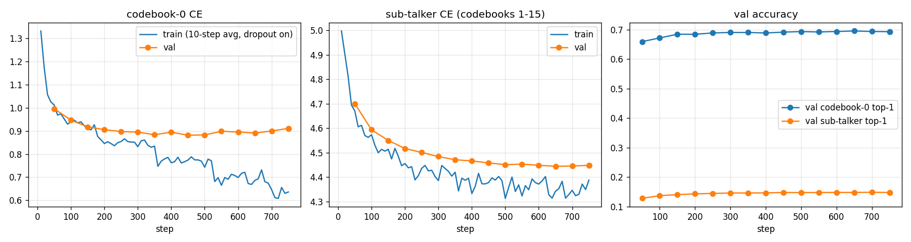

# qwen3-tts-hindi

LoRA fine-tune of **Qwen3-TTS-12Hz-1.7B-Base** for **Hindi female speech**, with the full training code, a corrected loss-alignment
implementation, inference helpers and CPU tests.

> **Status: pre-release.** Training completed and the adapter is intact (see `docs/EVALUATION.md`). The original notebook's export step
> crashed, so **no fine-tuned audio, CER or listening test exists yet**. The export bug is fixed here and covered by tests, but the
> re-exported model has **not** been reloaded or synthesised. See `docs/AUDIT.md` and `docs/RELEASE_CHECKLIST.md`. Weights are not
> published until the dataset licence is verified (`docs/LICENSING.md`).

## Quickstart (inference) - UNVERIFIED end-to-end until the checklist is complete
```bash
pip install -r requirements-inference.txt && pip install -e . --no-deps
python -m qwen3_tts_hindi "नमस्ते, आप कैसे हैं?" -m <hf-username>/qwen3-tts-1.7b-hindi-female -o out.wav
```
```python
from qwen3_tts_hindi import HindiTTS
tts = HindiTTS.from_pretrained("<hf-username>/qwen3-tts-1.7b-hindi-female")   # or a local export dir
wav, sr = tts.synthesize("नमस्ते, आप कैसे हैं?", seed=0)
```
### Important: how Hindi works here
Hindi is **not** a language id of the upstream model (`language="Hindi"` raises `ValueError`). The fine-tune uses the `language="auto"` layout
with `non_streaming_mode=True`, Devanagari input, and one fixed speaker `hindi_female`. `HindiTTS` hard-codes this. Raw usage: `examples/raw_qwen_tts_usage.py`.

## What is in the repo
| Path | Purpose |
|---|---|
| `src/qwen3_tts_hindi/` | inference wrapper + CLI (lazy heavy imports) |
| `training/` | **verbatim** notebook scripts: data prep, LoRA training, export (+2 marked patches) |
| `configs/` | original config (Kaggle paths) and local-path variant (same hyper-parameters) |
| `scripts/` | pipeline runner, adapter->safetensors, release-dir verifier, training-curve plot |
| `tests/` | 21 CPU tests incl. loss-equivalence on a tiny random Qwen3-TTS talker |
| `docs/` | AUDIT, TRAINING, EVALUATION, LICENSING, RELEASE_CHECKLIST, real training metrics + curves |
| `model_card/README.md` | Hugging Face model card (draft, with TODOs) |

## Technical contributions
1. **Loss-alignment fix** - the library's helper path shifts labels twice (talker) and grades sub-talker column *j* against codebook *j+2*. `compute_loss` shifts once and grades all 15 sub-codebooks. Proven equal to the library's single-shift loss and to the explicit two-ahead formula in `tests/test_loss_alignment.py`.
2. **Hindi without new language ids** - trained under the `auto`/non-streaming layout; layout parity with `generate()` asserted in tests.
3. **Custom LoRA over talker + text projection + code predictor** (36.0 M trainable parameters, 1.85 %) merged into a standalone `custom_voice` checkpoint with a baked speaker embedding.
4. **Export validation** against the base snapshot (found and fixed a bug that silently dropped the codec weights).

## Results (honest summary)
Teacher-forced validation metrics only (best checkpoint, step 500): codebook-0 CE 0.883 (top-1 0.694), sub-talker CE 4.451 (top-1 0.148).
These do **not** establish intelligibility. Overfitting begins after ~step 250. Single speaker, ~10.2 h training audio, 112 validation utterances.
Details and all caveats: `docs/EVALUATION.md`. 

## Reproduce training (Kaggle original: 2x T4, 5.3 h) - see `docs/TRAINING.md`
```bash
pip install -r requirements-train.txt
HTTS_CONFIG=configs/train_hindi_female.local.json bash scripts/run_pipeline.sh
```

## Tests
```bash
pip install torch qwen-tts==0.1.1 safetensors pytest && pip install -e . --no-deps && pytest -q tests   # 21 passed (CPU)
```

## Limitations
One speaker; Devanagari text only; trained on clips <=15 s (long text untested); no CER/MOS yet; merged-bf16 vs adapter audio equivalence untested; only torch 2.10.0 (training) and 2.14.1 (CPU tests) exercised.

## Responsible use
The model reproduces one real speaker's voice. Do not use it to impersonate or deceive. See `docs/LICENSING.md`.

## License & citation
Code: Apache-2.0 (`LICENSE`, `NOTICE`). Weights: pending dataset-terms verification. Cite via `CITATION.cff`; also cite Qwen3-TTS and the IndicTTS dataset.
